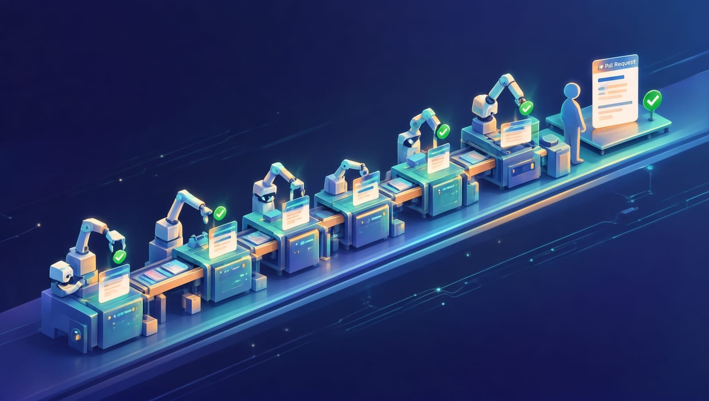

<div align="center">

# dsh-factory

<!-- release-state-note -->

**A multi-project development factory for DeepSeek Harness: every card runs in its own session and git worktree. The build session commits and pushes its branch, an independent self-reviewer opens the one draft pull request, a PR reviewer records a verdict, and you merge; the card completes only when the remote PR reports merged.**



English · [简体中文](docs/README.zh-CN.md)

</div>

---

## What it does

dsh-factory turns repositories into a self-running development line: you manage projects on a kanban board, the engine carries each card from intake to a reviewed branch, and you keep the merge button.

- **A factory per project.** Work is organised as project → one board → cards. A project is an absolute root path plus the repositories under it, and its board is created with it. The full-page manager offers a sidebar or a top tab strip (switch with **View**), remembers your view and selected project across reloads, and refreshes the board as sessions and stages change.
- **Isolated by construction.** Every dispatched card gets its own DSH session and its own git worktree under a per-project directory, so two cards never share a working tree. A global worktrees-root setting decides where new worktrees go; leave it blank for `~/dsh-factory-worktrees`. The root must stay outside the DSH data directory.
- **An automated pipeline with independent reviews.** Inbox → Triage → Plan → Build → Self-review → PR review → Done. The build session verifies the change, commits only the paths frozen at decision time and pushes the card branch — it does not open a PR. A separate self-review session checks that pushed branch and, on approval, opens the single **draft** PR from the head the backend re-read. A third, read-only PR-review session records a verdict. You merge; the card reaches `done` only on the real remote merge fact. No path merges, closes issues, force-pushes or writes another branch.
- **Continuation instead of restarts.** Advancing a stage keeps the same worktree and branch: a live session continues, an ended one is rebuilt onto its on-disk history, and only unusable history starts a fresh session, with the fallback recorded on the card. A card that fails three times in a row is marked stalled and never retried automatically.
- **Issue intake, deduplicated.** Bind a GitHub repository and a target board; open issues become cards on each poll, deduplicated by repository and number. Binding is explicit — the engine never guesses a repository at runtime — and you can change or clear it in project settings.
- **Stage rules that only narrow.** The default is full auto. Of the six stage rows, only four rules have engine read points and can be switched off to hold a card for a person: Inbox auto-start, Planning auto-approve, Self-review auto-start and PR-review auto-start. The other checkboxes are fixed on and dimmed with a hover hint. Pausing a project or taking over a card also blocks later automatic steps.
- **Bundled process skills.** The package installs phase skills for triage, plan, build, self-review, review and rereview, plus a skill that inspects a repository and registers it as a project through `/factory`. Setup commands and files to copy come from the target repository's own `AGENTS.md` / `CONTRIBUTING`, not from plugin presets.
- **Sessions and reports on the card.** A dispatched card shows its live session title — click to open that conversation — and a **View reports** button with every stage report (author, time, Markdown rendered, raw HTML not executed). Replies follow the display language set in DSH.

## Install

```sh
dsh plugin --profile web add @summerscar/dsh-factory
```

Refresh, open **Settings** (the gear at bottom-left), then choose **Project Factory** in the left nav to open the board.

## Use

1. Create a project with its absolute root path. If the root is a git checkout whose `origin` is a github.com HTTPS or SSH URL, the repository binding is filled in automatically; otherwise the project is still created and the reason shows in its settings. The page header shows the current binding — click it to edit.
2. Add cards to the project's board (created with the project), or let intake pull issues in from the bound repository.
3. Dispatch a card. It runs in its own session and worktree, and the card shows the linked session and every stage report.
4. Plans are approved automatically by default, so a card moves from `plan` to `build` in the same worktree. To hold a stage for a person, switch off the applicable rule in project settings; pausing the project or taking over a card blocks later automatic steps too.
5. The build session pushes the card branch without a PR. An independent self-review session checks it and opens one **draft** PR from the approved head; a separate read-only PR-review session records a verdict. Merge the draft PR yourself. When the host observes the merge, `syncRule` moves the card to `done`; a PR closed without merging only produces a suggestion to return to `build`.

### Register projects from a conversation

- `/factory add` — register this session's working directory as a project.
- `/factory add <absolute-path> [project name]` — register that repository; the directory name is used when no name is given.
- `/factory inspect <absolute-path>` — read-only listing of the repository's raw facts: root entries, ignore files, manifests and the declared package manager. It declares no project type and creates nothing.

`add` hands the request to the session's agent, which follows the bundled add-project skill: inspect the repository, read the files that matter, propose `copyFiles` and `postCreate`, and create the project once you agree. The setup command and local files to copy come from the target repository's own `AGENTS.md` / `CONTRIBUTING`.

### GitHub access

Each project resolves its own GitHub identity and shows the result on an identity card: which account is in use, where it came from, whether the local checkout is bound to the right remote, and an on-demand permission check. Four identity layers are listed in priority order with the active one marked; when a connected source's account name cannot be read, the source is shown instead of a placeholder.

The layers, highest priority first, are a shared **OAuth App** (device flow, connected once in global settings and used by all projects), your local **`gh` login** (used as-is, nothing stored), a **global Token** (shared across projects), and a **per-repository Token** (last fallback). `GH_TOKEN` / `GITHUB_TOKEN` is the default value of the global Token tier; a separately saved global Token takes precedence when present, and the environment variable is never changed. Tokens are kept in DSH credentials — never in configuration, logs or state files — and the plugin ships no OAuth credentials of its own. The identity card reports a masked fingerprint, never a full token.

Connections and OAuth live only in global settings; a GitHub button on a project just takes you there. Repository binding (`owner/repo`) is separate: detected once at creation from a github.com `origin`, editable or clearable in project settings.

## Limitations

- **The git boundary is fixed.** The build session commits and pushes its own branch; the self-reviewer opens one draft PR from the approved head. Nothing merges, closes issues, force-pushes or writes another branch. The switchable stage rules can only stop a stage, never widen this boundary.
- **A pause does not stop work already running.** Pause/resume (global and per project) and per-card takeover stop the engine's automatic steps — dispatch, plan approval, self-review, delivery — but sessions already running keep going, and cards skipped during a pause are not caught up after resuming. Issue intake follows the repository binding and runs every tick regardless of pause.
- **Manual remote sync is suggestion-only.** Recording a remote PR snapshot never changes a card's column or approves its plan; `done` comes only from the engine's poll of a real merged PR.
- **No webhooks.** Issue changes arrive on the poll interval, not live.
- **GitHub only.** The GitLab review flow is not implemented.
- **Single machine.** Designed for a locally running DSH; no multi-replica coordination.
- **OAuth is a live device flow.** It runs in your browser and lasts only for that page session: refreshing mid-flow cancels it, and an unfinished code means starting again. Reconnecting is a local sign-out — the plugin cannot revoke the token on GitHub itself.
- **A per-repository token helps only that repository.** A token saved for sharing applies to all projects.
